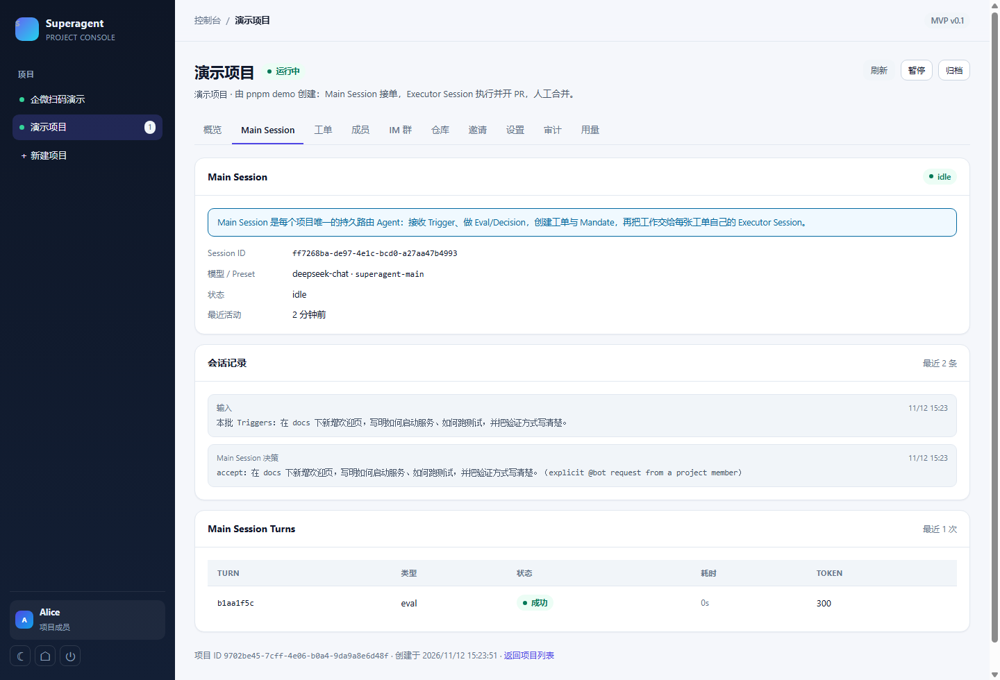
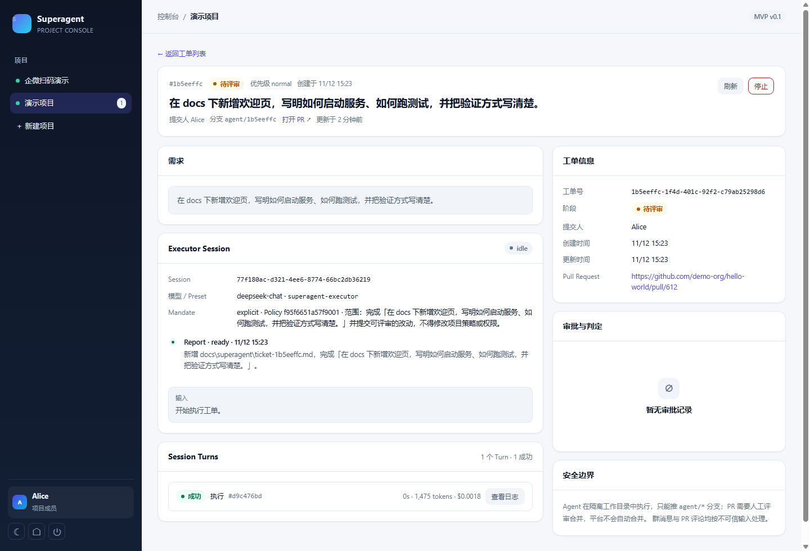
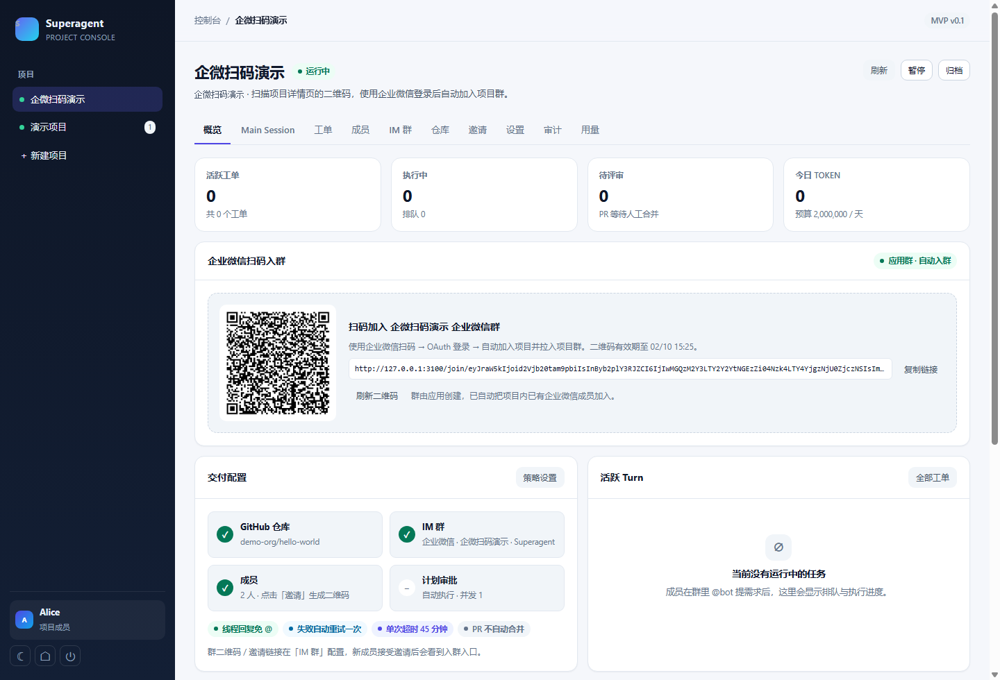
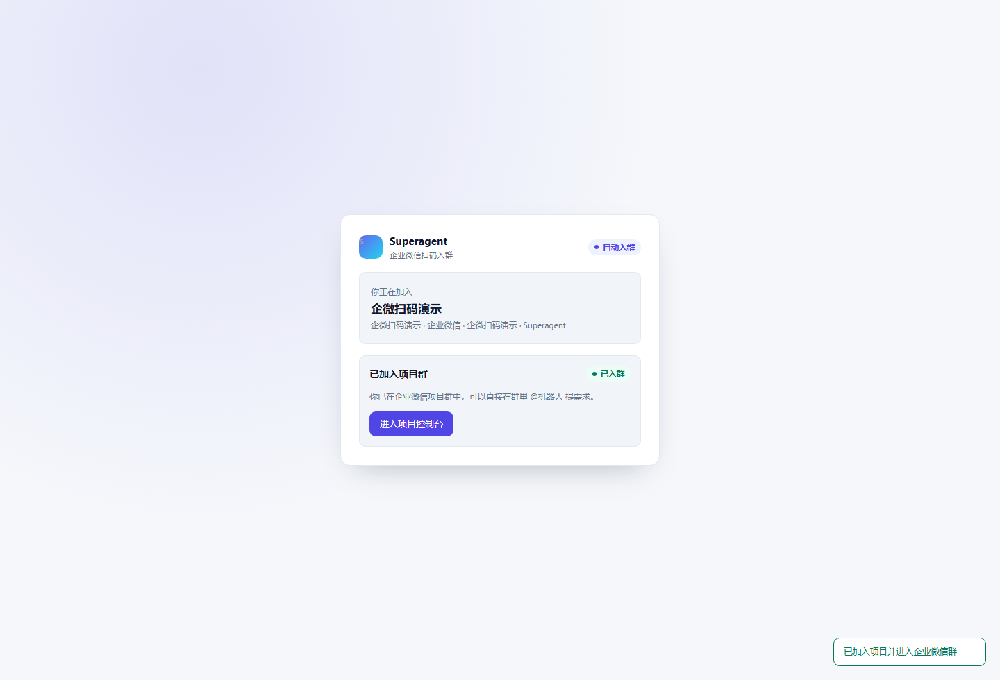
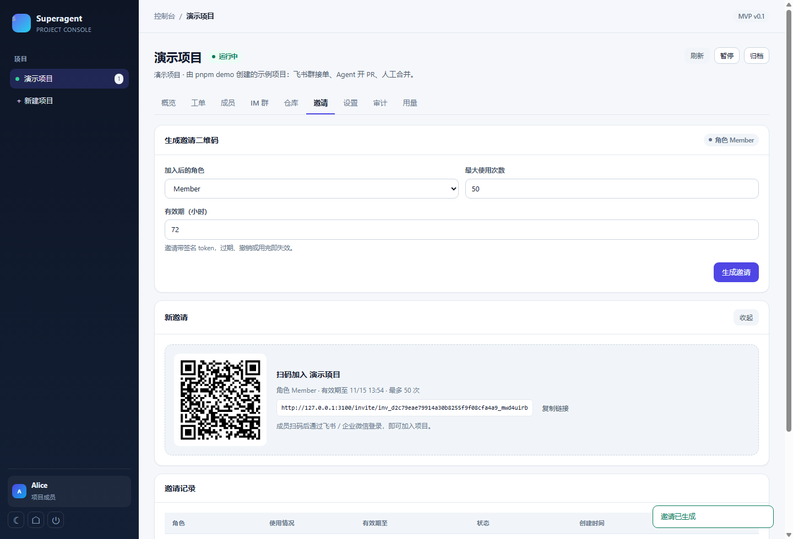
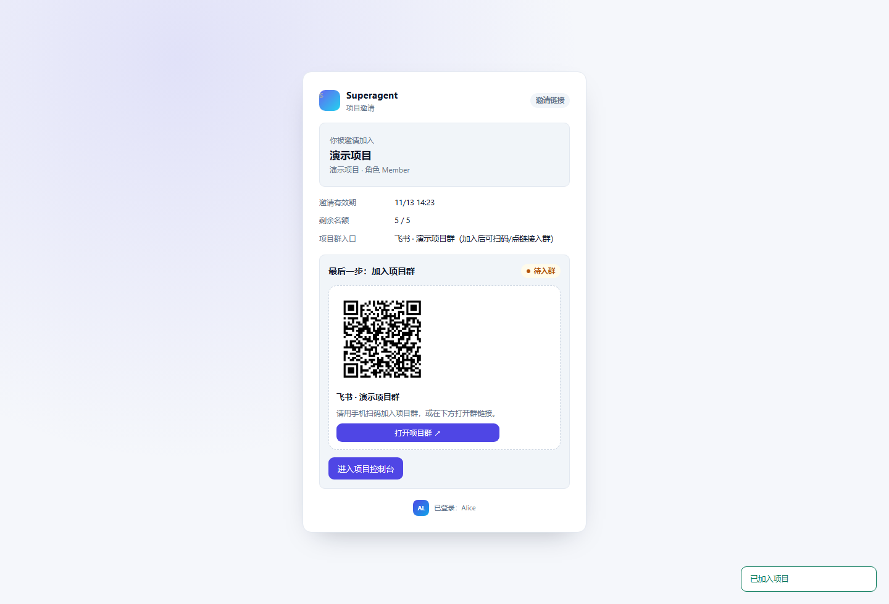
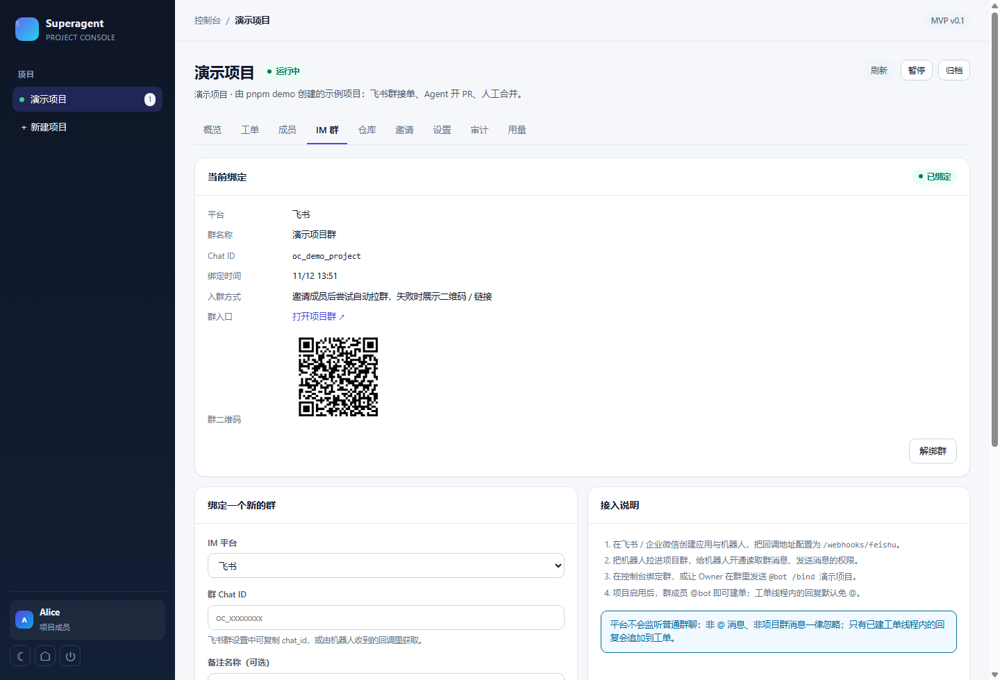

# Superagent Platform（MVP）

服务端多项目 Agent 平台的 MVP 实现，按 [`docs/STATUS.md`](docs/STATUS.md) 与 [`docs/CORE.md`](docs/CORE.md) 开发。

> **项目组 = 一个 GitHub 仓库 + 一组成员 + 一套策略 + 一个绑定的 IM 群。**
> 成员在群里 @bot 提需求；Agent 在隔离工作区改代码、跑测试、开 PR；人在群里或 PR 里评审；平台记录全链路审计。


## 当前状态

- **可运行**：控制面 API、Web 控制台、Worker、飞书 / 企业微信适配、GitHub App 适配、PGlite/Postgres、DB/Redis 队列、Outbox 通知、Docker Compose 部署文件与文档均已实现。
- **核心是双 Agent**：每个项目一个持久 **Main Session**（Trigger → Eval/Decision → Ticket/Mandate），每张工单一个持久 **Executor Session**（Assignment → Report → PR）。旧的 plan/execute Run 已移除。
- **开箱即用的是演示链路**：`pnpm demo` 使用 Mock GitHub + Fake Agent Runtime，在没有外部凭据的机器上跑通「@bot → Main Session → Executor Session → PR → 合并关闭」。
- **接真实环境需要配置**：飞书应用、GitHub App、Postgres/Redis，以及 Agent Runtime。支持外部 `AGENT_COMMAND`（DSH headless），或 `AGENT_RUNTIME=openai` 直连 OpenAI-compatible LLM（见 [部署文档](docs/DEPLOYMENT.md)）。
- 已知限制与和原方案的差异见 [STATUS.md](docs/STATUS.md)。

## 快速开始（无需外部凭据）

要求：Node.js ≥ 22.19，pnpm ≥ 10。

```bash
cd platform
pnpm install
pnpm build          # 构建 Web 控制台与服务端
pnpm demo           # 初始化演示数据、跑通一次工单，并在 :3100 启动
```

打开 <http://127.0.0.1:3100>，用**开发登录**输入昵称 `Alice`（Owner）或 `Bob`（Member）。

演示会：

1. 创建项目「演示项目」，绑定 Mock 仓库 `demo-org/hello-world` 和飞书群 `oc_demo_project`；
2. 生成一条邀请链接，并创建「企微扫码演示」项目：项目详情页直接显示企业微信扫码入群二维码（演示使用模拟 appchat 群；配置真实 corp 凭据与智能机器人后走同一接口）；
3. 模拟一条 @bot 消息进入 **Main Session**，由它做 Decision 创建工单和 Mandate；
4. **Executor Session** 领取 Turn，在工作区产生真实文件改动，平台提交到 `agent/*` 分支并创建 Mock PR；
5. 把「已接单」「PR 已创建」推送到模拟飞书群（终端输出）。

> 想重新开始：停止 demo，删除 `platform/server/data` 后再次执行 `pnpm demo`。

本地接真实飞书/企业微信回调（隧道 + 单进程 Worker）见 [部署文档 §13](docs/DEPLOYMENT.md#13-本地接企业微信联调单进程)。

开发模式（API 与 Vite 热更新分开跑）：

```bash
pnpm dev:api     # http://127.0.0.1:3000，PGlite 落盘到 server/data/pglite
pnpm dev:web     # http://127.0.0.1:5173，代理 /v1 与 /webhooks
pnpm dev:worker  # 可选：独立 Worker 进程
```

常用校验：

```bash
pnpm typecheck
pnpm test
pnpm check      # typecheck + test + build
```

## 能力总览

| 能力 | 实现 |
| --- | --- |
| 多项目 / 单仓库 | 项目绑定一个 GitHub 仓库；项目间数据按 `project_id` 隔离 |
| 成员与角色 | Owner / Maintainer / Member / Viewer；邀请二维码、角色变更、移除 |
| 扫码入项目 + 入群 | 项目邀请二维码 → OAuth 登录 → 加入项目；企业微信应用群可在项目详情页直接展示扫码入群二维码，扫码后自动加入项目与项目群 |
| IM 接入 | 飞书（默认，含加密回调、验签、@bot 判定、线程回复）；企业微信（appchat 建群/拉人、OAuth、群二维码；**智能机器人长连接**接收群内 @ 与回复） |
| @bot 接单 | Main Session 只评估项目成员的 @bot Trigger；非 @、非成员、非项目群忽略；线程回复直接作为 Input |
| 命令 | `/status` `/cancel` `/retry` `/approve` `/bind` `/help` |
| Main Session | 每项目一个持久 Session；Eval → Decision（accept/ignore/attach/stop）→ Ticket + Mandate + 回复 |
| Executor Session | 每工单一个持久 Session；Assignment → Report（progress/waiting/ready/blocked/failed/dropped）→ PR |
| 工单阶段 | queued / working / plan_review / idle / review / blocked / failed / answer / done / cancelled |
| 审批 | 计划审批是 Executor 内部的门；批准写 approval Input 后续跑 |
| 订阅 / Input | 工单订阅自己的线程；线程消息、PR 评论、审批、Policy 变更都以 Input 投递 |
| GitHub | GitHub App installation token、分支推送、PR 创建、PR 合并/关闭、评论续跑、CI 状态回传 |
| 审批 | 计划审批（可配置强制）、PR 不自动合并、审批记录 |
| 通知 | Outbox 事务表 + 幂等发送 + 指数退避重试；无 IM 凭据时演示为模拟发送 |
| 审计 | Trigger → Eval/Decision → Ticket/Mandate → Turn/Report → PR/Approval 全链路 |
| 配额 | 每项目并发 Executor Turn、每日 Token 预算、单次运行超时、全局 Worker 并发 |
| 控制台 | 项目、Main Session、工单/Executor Session、Turn 日志、成员、仓库、群、邀请、策略、审计、用量 |
| 部署 | Dockerfile + Compose（api / worker / postgres / redis / caddy），HTTPS，健康检查 |

## 架构

```text
飞书/企业微信 ── webhook ──► Trigger ──► Eval 队列 ──► Main Session（每项目一个）
GitHub ──────── webhook ──► Ticket Input ──┐                 │ Decision
Web 控制台 ───── HTTPS ────► Console/API ───┼──────► Ticket + Mandate
                                           │                 │ Assignment
                                           │                 ▼
                                           │        Executor Session（每工单一个）
                                           │                 │ Report
                                           └──── report/PR ◄─┘
                                                             │
                                                    agent/* 分支 → PR
```

- Main Session 只路由：读 Policy、Trigger、开放工单和 transcript，返回 decisions；不执行代码。
- Executor Session 只做单张工单：持久目录与 transcript，返回 reports；平台负责 commit/push/PR。
- 所有模型调用都是 `session_turns` 中的 Turn；一个 Session 同时只有一个 running Turn。

- **控制面不执行 shell**：API 只做鉴权、状态与调度。
- **每张工单独立目录**：Executor Session 在 `${project}/tickets/${ticket}` 持久工作，不跨项目复用。
- **模型调用可替换**：通过 `TurnRuntime` 接入；支持 Fake、外部命令（DSH）和 OpenAI-compatible 直连三种运行时。
- **GitHub 用 App 短期 token**：按任务下发 installation token，任务结束失效。
- **IM Adapter 统一接口**：`verifyAndParse` / `send`，飞书与企业微信各自封装协议差异。

```text
platform/
├── server/                     # Node.js 22 + TypeScript + Fastify + Drizzle
│   ├── src/
│   │   ├── app/                # Fastify 组装、路由
│   │   ├── dual/               # Main/Executor Session、Engine、Prompt、Runtime、Worker、Views
│   │   ├── services/           # 项目、邀请、接入、GitHub webhook、审计、Outbox
│   │   ├── domain/             # 状态、命令、策略、消息、IM/GitHub 端口
│   │   ├── db/                 # Drizzle schema 与迁移
│   │   ├── im/                 # 飞书 / 企业微信适配（验签、加解密、发送、OAuth）
│   │   ├── github/             # GitHub App 客户端与 webhook 验签
│   │   └── worker/             # Git 交付、Worker 入口、进程内联 Worker
│   ├── drizzle/                # SQL 迁移
│   ├── public/                 # 构建后的 Web 控制台
│   └── tests/                  # Vitest：双 Agent 核心、服务、适配器、Webhook
├── web/                        # React 18 + Vite + TypeScript 控制台
├── docs/                       # 架构、API、部署、状态、UI 说明
├── deploy/                     # Agent Runtime wrapper 模板
├── Dockerfile / docker-compose.yml / Caddyfile / .env.example
└── scripts/ui-screenshots.mjs  # 视觉回归截图工具（Chrome CDP）
```

## 界面

| Main Session | 工单 / Executor Session |
| --- | --- |
|  |  |

| 企业微信扫码入群 | 扫码后自动入群 |
| --- | --- |
|  |  |

| 邀请二维码 | 扫码入群 |
| --- | --- |
|  |  |

| 深色主题 | IM 群与入群配置 |
| --- | --- |
|  |  |

更多页面与设计说明见 [UI.md](docs/UI.md)。

## 文档

- [ARCHITECTURE.md](docs/ARCHITECTURE.md)：双 Agent 模型、数据模型、请求链路、Turn/Report、Queue/Outbox、安全设计
- [REWRITE.md](docs/REWRITE.md)：本次从 plan/execute Run 迁移到 Main/Executor Session 的目标与协议
- [API.md](docs/API.md)：REST API、Webhook、内部接口、鉴权与错误码
- [DEPLOYMENT.md](docs/DEPLOYMENT.md)：Docker Compose、飞书/GitHub App 配置、Agent Runtime 接入、备份与运维
- [STATUS.md](docs/STATUS.md)：FR / 验收标准逐条对照、测试映射、与方案的差异和已知限制
- [CORE.md](docs/CORE.md)：agentd 风格 Router/Worker 内核的启用方式、本地仓库与当前迁移边界
- [UI.md](docs/UI.md)：信息架构、设计令牌、页面状态与截图

## 安全边界

- 所有业务查询按 `project_id` 强制隔离；跨项目访问返回 404。
- 会话使用 HttpOnly Cookie；写请求校验 CSRF；Webhook 验签 + 事件 ID 幂等。
- GitHub 只允许推送 `agent/*` 分支，不自动合并，建议开启 branch protection。
- Agent 工作目录隔离；容器部署时 Worker 不挂载宿主目录、不暴露 Docker socket。
- 群消息、Issue、PR 评论全部按不可信输入处理；授权与成员校验在模型之外执行。

## License

[MIT](LICENSE)。
