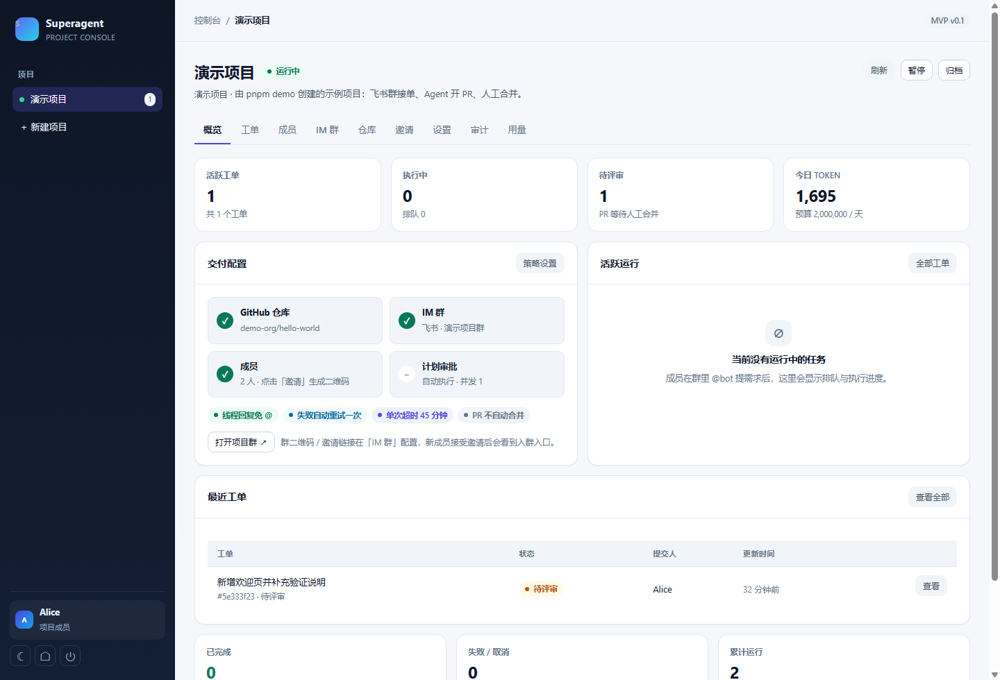
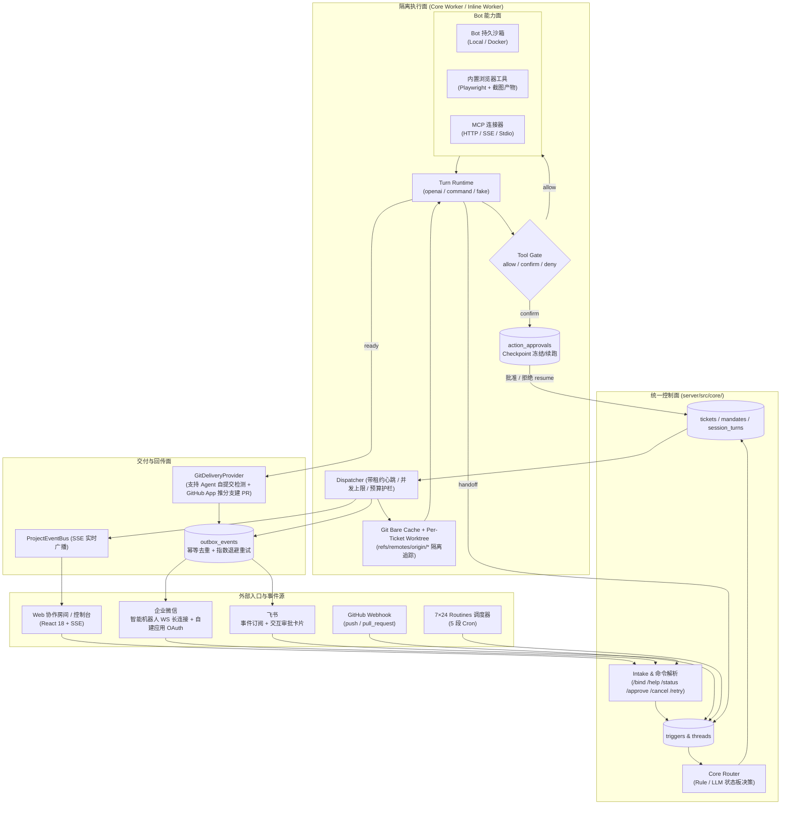

# Superagent Platform — 多角色产研数字员工平台

> 让多个可配置的 AI 数字员工（研究员、产品经理、全栈工程师、QA 测试）像真实同事一样入驻 Web 协作房间与企业微信 / 飞书群聊：在独立沙箱中协作接力、受工具级人工审批保护，并通过 GitHub App 交付真实可审查的 Pull Request。



---

## 一、设计理念（Design Philosophy）

Superagent Platform 围绕「**把 AI 从一次性聊天框，变成可协作、可治理、可交付的数字研发团队**」这一目标，提炼出六条核心设计原则：

### 1. 数字员工是团队成员，而非临时会话
每个项目维护一支可编排的 **Bot 团队（Roster）**。每个 Bot 拥有独立的人设 Prompt、角色职责、模型配置、工具权限策略与持久沙箱环境（如默认内置的 4 角色产研模板：`@researcher`、`@pm`、`@engineer`、`@qa`）。成员之间可通过结构化的 `handoff` 工具显式交接上下文，形成「调研 → 拆解 → 编码提 PR → 回归验证」的流水线协作，同时受 `maxHandoffHops`、防自交接和预算熔断保护。

### 2. 外部 IM 单入口，平台内多 Bot 路由
在企业微信 / 飞书群中，团队只需拉入**一个**统一机器人入口（如 `@Superagent`），即可在群里通过纯文本 `@engineer`、`@pm` 点名委派，或直接描述需求交由 **Core Router** 按职责自动分派。所有 Bot 回帖统一携带 `[角色 · 职责]` 署名，并与 Web「协作房间」通过 SSE 实时双向同步。

### 3. 控制面与执行面严格分离（Router vs. Executor）
- **Router（决策面）**：只读取当前线程的状态板（项目策略、可用 Bot、活跃工单、历史上下文与本批触发事件），输出严格校验的结构化决策 JSON（`new` / `attach` / `ignore` / `stop` / `command`），**绝不直接读写代码或执行命令**。
- **Executor（执行面）**：在隔离的 Git Worktree 与沙箱中运行，专注读代码、改文件、跑验证与交接；**禁止 Agent 直接 `git push` 或操作远端 PR**，最终交付统一收口到平台 `GitDeliveryProvider`（通过短生命周期 GitHub App Installation Token 推送分支并开 PR），确保交付安全且可追溯。

### 4. Suggest, don't send（工具级审批与断点续跑）
对高风险操作遵循「先提议、经确认再执行」：
- 每个工具（含内置工具、浏览器工具、外部 MCP 工具）均可配置 `allow` / `confirm` / `deny` 策略；
- 命中 `confirm` 时，Executor **自动冻结当前 Turn 并将完整对话与待调用参数持久化为 `checkpoint`**，向 Web 审批收件箱与飞书交互卡片推送操作预览；
- 经人工批准或拒绝后，Turn 从断点无缝续跑，不丢失上下文；
- 代码合入主干保留人工 Review 边界，Bot 只开 PR 不私自合入 `main`。

### 5. 零门槛渐进式接入（Progressive Adoption）
所有外部系统都是可插拔连接器，而非前置门槛：
- **本地开箱即用**：默认内置嵌入式 PGlite 数据库、`fake` 运行时与 `mock` GitHub，一行 `pnpm demo` 即可完整体验；
- **按需平滑升级**：随时在 `.env` 中切换为真实 PostgreSQL + Redis、任意 OpenAI-compatible 大模型（DeepSeek / OpenAI / vLLM 等）、企业微信（智能机器人长连接 + 自建应用扫码 OAuth）、飞书、真实 GitHub App 与 Docker 持久沙箱。

### 6. 静默自治与全链路可观测（Quiet-by-Default & Observable）
- **7×24 自治巡检**：支持 Cron 定时与 GitHub 事件触发，遵循「**无事不扰（quiet-when-clean）**」原则——巡检无异常时静默归档，仅在发现问题或产出变更时通知团队；
- **实时围观与全量审计**：Web 房间右侧面板通过 SSE 实时流式呈现每个 Turn 的工具调用、终端日志、浏览器截图产物；Token 消耗、成本估算、Router 决策与所有管理操作均写入审计与用量表。

---

## 二、系统架构

### 整体分层与数据流



### 核心子系统说明

| 子系统 | 源码位置 | 职责与关键机制 |
| --- | --- | --- |
| **HTTP API & 控制台装配** | `server/src/app/` | Fastify 实例、Cookie Session + CSRF 校验、RBAC 权限（`owner` / `maintainer` / `member` / `viewer`）、SSE 实时流、Webhook 与 REST 路由 |
| **统一决策内核（Router）** | `server/src/core/router/` | 渲染线程状态板（区分历史摘要与当前批次防提示词污染），支持 `rule` 与 `llm` 双模式，内置宽容 JSON 提取、空值归一化与成本记账 |
| **执行调度内核（Worker）** | `server/src/core/worker/` | 按项目并发上限认领 `session_turns`、租约心跳与僵死回收（Reaper）、多 Bot `handoff` 跳数与防自交接守卫、独立进程或 `INLINE_WORKER=true` 内嵌运行 |
| **多模型运行时与门禁** | `server/src/core/agent/` | `OpenAiTurnRuntime`（任意 OpenAI-compatible 端点 + Tool Calling）、`ProcessTurnRuntime`（外部 CLI Agent）、`FakeTurnRuntime`（演示/测试），内置 `gate.ts` 工具审批门禁 |
| **Git 缓存与 PR 交付** | `server/src/core/worker/worktree.ts`<br/>`server/src/core/worker/delivery.ts`<br/>`server/src/worker/git.ts` | 每项目维护 `--bare` 缓存仓（`+refs/heads/*:refs/remotes/origin/*` 避免 `fetch --prune` 破坏未推分支），每工单独立 Worktree；交付阶段自动兼容「未提交改动」与「Agent 已本地 commit 领先主干」两种场景，统一推送并创建 GitHub PR |
| **沙箱 / 浏览器 / MCP** | `server/src/core/sandbox/`<br/>`server/src/core/mcp/` | `LocalProcessSandboxProvider` 与 `DockerSandboxProvider`（`deploy/bot-sandbox.Dockerfile`）；`browser_open/click/type/extract/screenshot` 产物自动归档；MCP 支持 Streamable HTTP / SSE / Stdio 协议与一键发现工具 |
| **7×24 定时与事件巡检** | `server/src/core/routines/` | 标准 5 段 Cron 解析与防重调度、GitHub `push`/`pull_request` 触发器、无异常静默（`notifyOnQuiet=false`） |
| **IM 双向适配与可靠回传** | `server/src/im/`<br/>`server/src/services/outbox.ts` | **企业微信**：智能机器人 WebSocket 长连接（群聊 `@` 与单聊 `p2p:` 自动适配）+ 自建应用 PC 扫码 `wwlogin` / 企微内 `oauth2` + `appchat` 建群与扫码入群；**飞书**：事件回调 + 交互式审批卡片；所有出站走 `outbox_events` 幂等队列 |
| **Web 工作台** | `web/src/` | React 18 + Vite + TypeScript，Apple 极简视觉风格与浅色/深色主题；顶部主导航收敛为 5 个高频视图（协作房间、Bot 团队、审批收件箱、定时巡检、连接器），次级管理页收入「更多」菜单 |
| **存储与迁移** | `server/src/db/`<br/>`server/drizzle/` | Drizzle ORM + PostgreSQL（开发/演示零配置自动回落本地 PGlite），涵盖 `0000`–`0010` 完整迁移 |

---

## 三、快速开始

环境要求：**Node.js ≥ 22**、**pnpm ≥ 10**。

### 1. 零凭据本地体验（推荐首次上手）

```bash
pnpm install
pnpm build          # 构建 Web 控制台与服务端
pnpm demo           # 初始化 4 角色产研团队、示例工单与 QA 巡检，并在 :3100 启动
```

浏览器打开 <http://127.0.0.1:3100>，使用**开发登录**输入 `Alice`（Owner）或 `Bob`（Member）即可体验：
1. **协作房间**：在「主协作群」`@engineer` / `@pm` 派单，右侧实时围观 SSE 执行流；
2. **Bot 团队**：编辑各角色人设、工具策略，或开启与单个 Bot 的 1v1 私聊；
3. **审批收件箱**：模拟高风险工具调用拦截、审批与断点续跑；
4. **定时巡检**：查看「每日 09:00 QA 回归与依赖巡检」并一键试跑；
5. **连接器**：绑定本地 Git 仓库 / GitHub App，或接入外部 MCP 服务。

### 2. 本地开发模式

```bash
pnpm dev:api        # 服务端 API（http://127.0.0.1:3000，设 INLINE_WORKER=true 可同进程跑 Worker）
pnpm dev:web        # 前端开发服务器（http://127.0.0.1:5173，自动代理 /v1 与 /webhooks）
pnpm dev:worker     # 独立核心 Worker 进程（生产推荐与 API 分离部署）
```

### 3. 接入真实大模型 + 企业微信 + GitHub App（端到端生产形态）

复制 `.env.example` 为根目录 `.env`，按需填入关键变量：

| 模块 | 关键环境变量 | 说明 |
| --- | --- | --- |
| **基础与运行模式** | `PUBLIC_BASE_URL`、`INLINE_WORKER`、`PGLITE_DIR` / `DATABASE_URL` | 公网 HTTPS 入口（本地联调可用 `cloudflared` 隧道）；生产建议配 `DATABASE_URL` 且关闭 `INLINE_WORKER` |
| **真实大模型** | `AGENT_RUNTIME=openai`、`CORE_ROUTER=llm`<br/>`LLM_BASE_URL`、`LLM_MODEL`、`LLM_API_KEY` | 支持 DeepSeek、OpenAI 及任意 OpenAI-compatible 网关 |
| **企业微信（智能机器人）** | `WECOM_BOT_NAME`、`WECOM_BOT_ID`、`WECOM_BOT_SECRET` | WebSocket 长连接收发群 `@` 与单聊消息，无需配置公网入站域名即可先跑通收发 |
| **企业微信（自建应用）** | `WECOM_CORP_ID`、`WECOM_AGENT_ID`、`WECOM_SECRET`<br/>`WECOM_TOKEN`、`WECOM_ENCODING_AES_KEY` | 支持 PC 浏览器扫码登录（`wwlogin`）、企微内免登（`oauth2`）及应用群自动拉人 |
| **真实 GitHub App** | `GITHUB_MODE=app`、`GITHUB_APP_ID`、`GITHUB_APP_SLUG`<br/>`GITHUB_APP_PRIVATE_KEY_PATH` | App 需开启 Repository `Contents: Read & write` 与 `Pull requests: Read & write`，Callback/Setup URL 指向 `{PUBLIC_BASE_URL}/v1/github/install/callback` |

连通性自检（不打印任何密钥）：

```bash
pnpm --dir server exec tsx src/scripts/wecom-probe.ts
```

IM 群聊 / 单聊常用指令（群聊需 `@Superagent` 触发）：

| 指令 | 作用 |
| --- | --- |
| `/bind <项目标识>` | 将当前企微群或单聊会话绑定到指定项目，并同步挂载至 Web「主协作群」 |
| `/help` | 查看可用命令列表 |
| `/status [工单号]` | 查看当前线程或指定工单的最新阶段与状态 |
| `/approve [工单号]` | Maintainer/Owner 批准处于 `plan_review` 的执行计划 |
| `/retry [工单号]` | 重新排队并重试指定工单 |
| `/cancel [工单号]` | 取消进行中的工单与 Turn |

---

## 四、目录结构

```text
superagent-platform/
├── server/
│   ├── src/
│   │   ├── app/                # Fastify 应用组装与 REST/SSE/Webhook 路由
│   │   ├── core/               # 统一内核：agent(openai/gate)、router、worker、sandbox、mcp、routines
│   │   ├── services/           # 领域服务：项目、成员、Bot、Room、审批、连接器、巡检、Outbox、事件总线
│   │   ├── db/                 # Drizzle Schema、连接管理（PostgreSQL / PGlite）与迁移器
│   │   ├── domain/             # 纯域模型与规则（状态机、OAuth URL、指令解析、策略 Schema）
│   │   ├── im/                 # 企业微信（WS 智能机器人 + 自建应用）与飞书（含交互卡片）适配器
│   │   ├── github/             # GitHub App JWT 鉴权、仓库查询、PR 创建与 Webhook 验签
│   │   ├── worker/             # Git 操作封装（RealGitOps / FakeGitOps）与独立 Worker 入口
│   │   └── scripts/            # 运维诊断脚本（如 wecom-probe.ts）
│   ├── drizzle/                # SQL 数据库迁移（0000 ~ 0010）
│   └── tests/                  # Vitest 单元测试与端到端集成测试
├── web/                        # React 18 + Vite + TypeScript 极简工作台
├── deploy/                     # bot-sandbox.Dockerfile 与运行时包装模板
├── docs/                       # 架构、内核、API、部署与设计演进文档
└── docker-compose.yml          # 生产编排：api + core-worker + postgres + redis + caddy
```

---

## 五、校验与测试

```bash
pnpm typecheck      # server + web 全量 TypeScript 类型检查
pnpm test           # Vitest 单元与集成测试套件
pnpm build          # 构建 Web 静态资源与服务端产物
pnpm check          # 一键执行 typecheck + test + build
```

---

## 六、延伸文档

- [架构设计文档（Grok Bot 演进版）](docs/superpowers/specs/2026-11-26-grok-bot-architecture-design.md)
- [分阶段实施计划](docs/superpowers/plans/2026-11-26-grok-bot-implementation-plan.md)
- [系统架构说明](docs/ARCHITECTURE.md) · [核心内核说明](docs/CORE.md) · [界面说明](docs/UI.md)
- [API 文档](docs/API.md) · [部署与联调指南](docs/DEPLOYMENT.md) · [实现状态与验收对照](docs/STATUS.md)

## License

[MIT](LICENSE)
