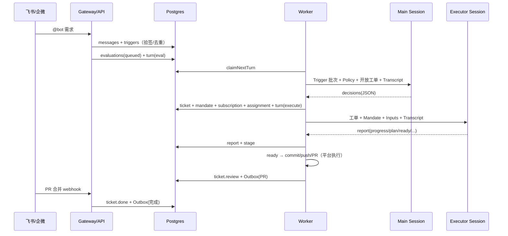

# 架构设计（双 Agent 核心）

本服务按 `DEVELOPMENT_PLAN.md` 与 dsh-superagent 的领域模型重构为 **Main Session / Executor Session 双 Agent**：

- **每个项目一个持久 Main Session**：接收 Trigger、做 Eval/Decision、创建 Ticket/Mandate、路由和回复。
- **每张工单一个持久 Executor Session**：在独立目录里工作，通过 Report 汇报 progress / waiting / ready / blocked / failed / dropped。
- 鉴权、项目/成员、IM、GitHub、Outbox、审计与控制台作为**服务壳**复用。

> 旧版“确定性 intake + plan/execute Runs”已移除。数据库中的 `runs` / `run_events` 在迁移 0004 中删除。

## 1. 进程与模块

```text
┌──────────────────────────── api 进程 ────────────────────────────┐
│ Fastify                                                            │
│  ├─ /webhooks/feishu|wecom  Channel Gateway → Trigger             │
│  ├─ /webhooks/github        PR/评论/CI → Ticket Input             │
│  ├─ /v1/*                   Console API（项目/工单/会话/审计）      │
│  ├─ /internal/*             Turn 事件回传                          │
│  └─ /healthz /readyz /metrics                                      │
│ 后台循环：Outbox 发送 · 失联 Turn 回收 · 过期会话清理               │
└───────────────┬──────────────────────────────┬────────────────────┘
                │ Postgres                      │ Redis/BullMQ（可选）
┌───────────────▼──────────────────────────────▼────────────────────┐
│ worker 进程                                                        │
│  claimNextTurn → Main eval 或 Executor execute                     │
│  Main: packet → TurnRuntime → Decision → Engine                    │
│  Executor: 持久目录 → TurnRuntime → Report → 平台交付 PR           │
└────────────────────────────────────────────────────────────────────┘
```

| 模块 | 代码位置 | 职责 |
| --- | --- | --- |
| Channel Gateway | `src/im/*`、`src/app/routes/webhooks.ts` | 验签/解密、归一化、去重、发送、OAuth；企业微信智能机器人长连接 `im/wecom-bot.ts` |
| Intake | `src/services/intake.ts` | 消息 → Trigger；未绑定群 `/bind` |
| Dual Engine | `src/dual/engine.ts` | Trigger 入库、Eval、Decision、Ticket/Mandate、Input、停/重试、PR 事件 |
| Sessions | `src/dual/sessions.ts` | Main/Executor Session、Turn 队列、Transcript、心跳、取消 |
| Prompts | `src/dual/prompts.ts` | 两个角色各自的系统提示词与 JSON 协议 |
| Runtime | `src/dual/runtime.ts` | Fake / 外部命令 Agent Runtime，写入 `result.json` |
| Worker | `src/dual/worker.ts` | 执行 Turn、工作区、Git/PR、Report |
| Views | `src/dual/views.ts` | 控制台 DTO、Main Session 视图、Turn 映射 |
| Service shell | `src/services/projects.ts`、`auth.ts`、`invites.ts`、`outbox.ts`、`audit.ts` | 项目、成员、邀请、通知、审计 |
| Console | `web/src/*` | 项目/工单/会话/运行/审计/用量 |

## 2. 核心模型

| 概念 | 持久化 | 说明 |
| --- | --- | --- |
| Main Session | `agent_sessions(role=main)` | 每个项目唯一；持久 transcript |
| Executor Session | `agent_sessions(role=executor, ticket_id)` | 每张工单唯一；持久 transcript + 目录 |
| Trigger | `triggers` | 一条 IM/GitHub 事件，`(provider, external_id)` 唯一 |
| Thread | `(project, provider, channel, thread_key)` | 订阅匹配键 |
| Eval | `evaluations` | 同一线程一个活跃 Eval；批量 Trigger |
| Decision | `evaluations.decision` | accept / ignore / attach / stop |
| Mandate | `mandates` | 工单的授权：Policy 版本、强度、scope、basis |
| Ticket | `tickets` | `stage` 是事实；`status` 是控制台兼容投影 |
| Subscription | `ticket_subscriptions` | 工单订阅自己的线程（本期只有 `own`） |
| Assignment | `assignments` | 一次 Executor Turn 的派工 |
| Report | `reports` | Executor 的结果/状态/问题/PR |
| Input | `ticket_inputs` | 线程消息、审批、Policy 通知等 |
| Turn | `session_turns` | 一次模型调用；队列与审计单位 |

## 3. 流程

### 3.1 新需求



### 3.2 新请求的准入

本期只把 **项目成员在绑定群内 @bot** 的消息送入 Eval。非成员、非 @、非项目群一律忽略；不做推断候选、bot 名单和 admission 表。

### 3.3 线程回复

- 工单创建时写入 `ticket_subscriptions(own, provider, thread_key)`。
- 订阅线程上的消息直接写 `ticket_inputs`，**不再走 Eval**。
- 工单处于 `review`/`idle`/`blocked`/`failed` 或已结束后收到人消息时，更新为 `queued` 并入队新的 Executor Turn；`plan_review` 阶段的人消息等待审批。
- 被人工停止（Mandate 撤销）的工单不会因输入自动恢复。

### 3.4 Plan approval

计划审批不是第二个 Agent，而是 Executor Session 内部的门：

1. `policy.planApproval=required` 且 `ticket.plan` 为空：Executor 第一轮只返回 `progress` + `plan`；
2. Ticket 进入 `plan_review`，通知 Maintainer；
3. 人批准 → 写 `approval` Input、记录 `approvals`、入队下一轮；
4. Executor 读到 `planApproved=true` 后执行并返回 `ready`。

### 3.5 PR 与结束

- Executor 只改工作区；平台创建 `agent/<short-id>` 分支、commit、push、PR（沿用仓库保护）。
- `ready` → `review` + PR 通知；PR 合并 → `done`；关闭未合并 → `cancelled`。
- 当前只跟踪一张 PR；后续可扩展多 PR。

### 3.6 Policy 变更

Policy JSON 的 hash 是 Policy version。每个 Mandate 记录版本。Policy 变更**不取消**在线工单，而是给受影响的 open ticket 写入 `policy` Input。恢复已结束工单时需要 Mandate 未撤销。

## 4. 状态

| Stage | 含义 | 控制台状态投影 |
| --- | --- | --- |
| `queued` | 等待 Turn | `triaged` |
| `working` | Executor 正在执行 | `running` |
| `plan_review` | 计划待审批 | `planned` |
| `idle` | Executor 等待下一次触发 | `running` |
| `review` | ready，PR 待评审 | `waiting_review` |
| `blocked` / `failed` | 需要人/重试 | `failed` |
| `answer` | 有 Attention 问题 | `running` |
| `done` / `cancelled` | 结束 | 同名 |

Turn：`queued → running → succeeded / failed / cancelled / timeout`。
同一 Session 同时只能有一个 running Turn；Main Session 的 eval 不受项目 worker 并发限制，Executor Turn 受 `maxConcurrentRuns` 限制。

## 5. Worker 与执行隔离

- Main Session Turn：scratch 目录，不克隆仓库；packet 包含 Policy、本批 Trigger、开放工单卡片和最近 transcript。
- Executor Turn：`${WORKSPACES_DIR}/${projectId}/tickets/${ticketId}` 持久目录，首次 clone，后续复用；turn 结束不删除，工单结束后由保留策略清理。
- 平台负责 Git/PR；Agent 不获得 GitHub token，模型进程环境不注入 installation token。
- 心跳每 15 秒写 `session_turns.heartbeat_at`；API/Worker 的 reaper 按 `RUN_LEASE_SECONDS` 回收失联 Turn，Executor Turn 超时会把 Ticket 置 `failed` 并通知。
- 停止工单会撤销 Mandate、取消 queued Turn、给 running Turn 写 `cancel_requested_at`；Worker 轮询后中止 Agent。

## 6. 协议

Main Session：

```json
{
  "decisions": [
    {
      "triggerId": "uuid",
      "action": "accept",
      "reason": "explicit request",
      "reply": "已接单",
      "ticket": {
        "title": "标题",
        "body": "原始需求",
        "scope": "允许的范围",
        "strength": "explicit",
        "planApproval": "required"
      }
    }
  ]
}
```

Executor Session：

```json
{
  "status": "progress | waiting | ready | blocked | failed | dropped",
  "summary": "给人看的结果",
  "plan": "计划（需要审批时）",
  "attention": { "question": "需要人回答的问题" },
  "branch": "可选，平台会校正",
  "tokens": 0,
  "cost": 0
}
```

外部命令 Runtime 读 `{workspace}` `{promptFile}` `{inputFile}` `{resultFile}`，把 `{"output": <协议对象>, "tokens": ..., "cost": ...}` 写入 `result.json`。

## 7. 安全

- 所有业务查询按 `project_id`；跨项目 404。
- Webhook 验签、事件 ID 幂等、限流；内部接口 Bearer token。
- 群消息/PR 评论作为不可信输入进入 packet；授权由 Engine 在模型之外执行。
- 只推 `agent/*`；不自动合并；建议 branch protection。
- Worker 非 root、无 Docker socket、无宿主目录；模型进程不注入 GitHub token。
- 审计覆盖 trigger、decision、ticket、turn、report、approval、PR、通知。

## 8. 与 dsh-superagent 的差异

| 原型 | 本服务 | 原因 |
| --- | --- | --- |
| DSH 原生 Session + 工具调用 | `TurnRuntime` + JSON 协议；真实 DSH 由命令包装器接入 | 服务可替换运行时，便于多项目与测试 |
| Main Session 有 14 个工具 | 本期 Main 只输出 decisions；命令仍是服务层确定性动作 | MVP 收窄，协议可扩展为工具调用 |
| 推断候选 / bot 名单 / admission 表 | 本期只处理成员 @bot | 与 `DEVELOPMENT_PLAN.md` 的 @ 版一致 |
| 自动 merge 规则 | 不自动合并 | 方案硬约束 |
| 多 PR 跟踪 / 上下文订阅 / subagent | 未实现 | 后续里程碑 |

## 9. 可观测性

结构化日志带 `turnId/projectId/ticketId`；`/metrics` 用 Executor Turn 状态映射 `superagent_runs_total`；`turn_events` 保存 Agent 事件；`audit_logs` 保存业务动作。每个 Ticket 可追溯 Trigger → Eval/Decision → Mandate → Turn/Report → PR → Approval。
