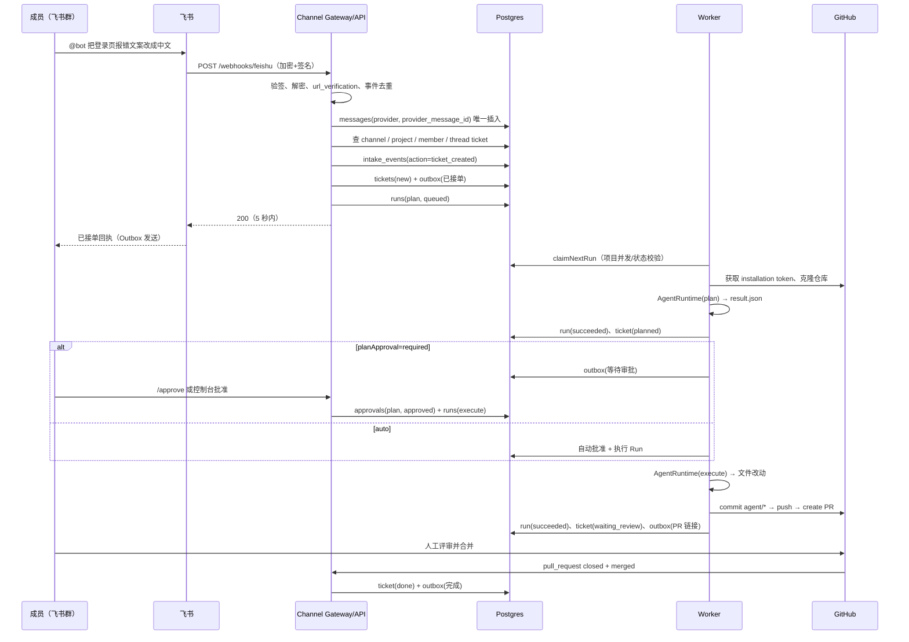

# 架构设计

本文说明 Superagent Platform MVP 的实现方式，以及它如何对应 `DEVELOPMENT_PLAN.md` 的模块、流程与约束。

## 1. 目标与边界

一个部署单元服务多个项目：

- 每个项目绑定**一个** GitHub 仓库、**一组成员**、**一套策略**、**一个主 IM 群**；
- 平台级每个 IM 平台一个 bot，按 `chat_id` 路由到项目；
- 只处理 @bot、命令、以及已有工单线程内的回复；
- Agent 在隔离工作目录中执行，产出 `agent/*` 分支与 PR；
- 控制台、审计与工单数据都在平台内，IM 只是通道。

不在 MVP 内：多仓库、自动合并、计费、跨项目记忆、LLM 消息 Router、插件市场、私有化交付。

## 2. 进程与模块

```text
┌──────────────────────────── api 进程 ────────────────────────────┐
│ Fastify                                                            │
│  ├─ /webhooks/feishu|wecom  Channel Gateway（验签、解密、去重）    │
│  ├─ /webhooks/github        GitHub Adapter（签名、PR/评论/CI）     │
│  ├─ /v1/*                   Console API（会话、RBAC、项目/工单）   │
│  ├─ /internal/*             Worker 事件回传（服务 token）          │
│  └─ /healthz /readyz /metrics                                      │
│ 后台循环：Outbox 发送 · 失联 Run 回收 · 过期会话清理               │
└───────────────┬──────────────────────────────┬────────────────────┘
                │ Postgres                      │ Redis/BullMQ（可选）
┌───────────────▼──────────────────────────────▼────────────────────┐
│ worker 进程                                                        │
│  claimNextRun / BullMQ Worker → executeClaimedRun                  │
│  克隆仓库 → AgentRuntime(plan|execute) → commit → push → PR        │
│  事件回传 run_events → 工单状态推进 → Outbox 通知                  │
└────────────────────────────────────────────────────────────────────┘
```

| 模块 | 代码位置 | 职责 |
| --- | --- | --- |
| Channel Gateway | `src/im/*`、`src/app/routes/webhooks.ts` | 验签/解密、事件归一化、消息去重、发送消息、OAuth |
| Mention Router | `src/domain/intake.ts`、`src/services/intake.ts` | 确定性分流：群绑定、@bot、命令、工单线程、成员、项目状态 |
| Project Service | `src/services/projects.ts` | 项目 CRUD、成员、仓库、群、installation |
| Ticket Service | `src/services/tickets.ts` | 建单、追加、状态机、审批、关闭 |
| Orchestrator | `src/services/orchestrator.ts` | 计划/执行 Run、配额、重试、失联回收、通知 |
| Worker | `src/worker/*` | 领取任务、工作目录、Git、PR、结果回传 |
| GitHub Adapter | `src/github/*` | App JWT、installation token、PR、webhook |
| Notification/Outbox | `src/services/outbox.ts`、`notifications.ts` | 事务内入队、幂等发送、退避重试 |
| Web Console | `web/src/*` | 项目、工单、运行、成员、群、邀请、审计、用量 |
| Audit/Usage | `src/services/audit.ts`、`usage.ts` | 审计与 Token/成本统计 |

## 3. 端到端：一条 @bot 消息



### 幂等与去重

| 层 | 键 | 行为 |
| --- | --- | --- |
| Webhook 投递 | `webhook_deliveries(provider, delivery_id)` | 重复投递直接返回成功，不重复处理 |
| 消息 | `messages(provider, provider_message_id)` 唯一 | 同一消息重复到达只记录一次 |
| 接入判定 | `intake_events(message_id)` 唯一 | 每条消息只产生一个判定 |
| 通知 | `outbox_events.dedupe_key` 唯一 | 同一业务事件只发一次 |
| Run | `runs` 部分唯一索引（ticket_id, status in queued/running） | 同一工单只有一个活跃 Run |

## 4. Mention Router

不做全量消息 Router，只做确定性判断（`decideIntake`）。优先级：

1. **Bot 消息 / 空消息** → 忽略（防止自循环）。
2. **没有绑定群** → 忽略；唯一例外：`@bot /bind <项目标识>`，要求发送者是该项目 Owner。
3. **项目 archived** → 忽略。
4. **发送者不是项目成员** → 忽略（不回复）。
5. **命令** `/status /help /cancel /retry /approve /bind`：
   - `/status`、`/help`：Viewer 及以上；
   - `/cancel`、`/retry`、`/approve`、`/bind`：Maintainer 及以上；
   - 未知命令提示帮助；无权限时明确回复（只对显式命令回复）。
6. **项目 paused**：不建单、不追加工单；只允许只读命令与取消。
7. **已有工单线程**：
   - `allowThreadReplies=true`（默认）→ 追加到该工单；`waiting_review` / `done` 会重开并触发新的执行；
   - `allowThreadReplies=false` 且未 @bot → 忽略；@bot 则新建工单。
8. **@bot** → 新建工单。
9. 其余 → 忽略（`not_mentioned`）。

每条判定写入 `intake_events(action, reason, command, ticket_id)`，不回复被忽略的消息。

> 已知取舍：绑定项目群中的非 @ 消息也会落一条 `messages` 记录用于审计和线程判定，但不会建单。数据保留期由部署控制（见 [DEPLOYMENT.md](DEPLOYMENT.md)）。

## 5. 数据模型

| 表 | 关键字段 | 说明 |
| --- | --- | --- |
| `users` | id, name, avatar, email, is_admin | 平台用户 |
| `identities` | user_id, provider, external_id | 飞书/企微/dev 身份，`(provider, external_id)` 唯一，不跨平台合并 |
| `auth_sessions` | token_hash, expires_at | HttpOnly 会话，库中只存哈希 |
| `projects` | name, slug, owner_id, status, policy_json, model_config | 项目；策略为 JSON |
| `project_members` | project_id, user_id, role | 角色 owner/maintainer/member/viewer |
| `repos` | project_id（唯一）, installation_id, owner, name, default_branch | 每项目一个仓库 |
| `project_installations` | project_id, installation_id | GitHub App 安装与仓库选择之间的过渡记录 |
| `channels` | project_id, provider, external_chat_id, status, config | 每个 provider+chat 唯一；每个项目最多一个 active 群；config 可存 `joinUrl`、`qrDataUrl`、`autoJoin`、企业微信群机器人 `webhookUrl` |
| `invites` | token_hash, role, expires_at, max_uses, used_count | 只存 token 哈希，明文只在生成时返回 |
| `tickets` | project_id, channel_id, thread_key, requester, title, body, status, plan, pr_url, branch | `(project, channel, thread_key)` 找活动工单 |
| `messages` | provider, provider_message_id（唯一）, text, thread_key, is_bot | 绑定的项目群内的消息 |
| `intake_events` | message_id（唯一）, action, reason, command, ticket_id | 路由判定记录 |
| `runs` | ticket_id, kind(plan/execute), status, worker_id, tokens, cost, branch, pr_url | 需满足每工单一个活跃 Run |
| `run_events` | run_id, type, message, payload | Agent 事件流（日志） |
| `approvals` | ticket_id, kind(plan/merge), actor_id, decision, comment | 审批记录 |
| `audit_logs` | project_id, actor, action, target, metadata | 只追加 |
| `usage` | project_id, day, runs, tokens, cost | 唯一 `(project_id, day)` |
| `outbox_events` | channel_id, kind, dedupe_key, payload, status, attempts | 事务性通知队列 |
| `webhook_deliveries` | provider, delivery_id | Webhook 幂等 |

**隔离约束**：所有业务表都有 `project_id`（或经由外键归属项目）；查询必须带项目条件。仓库、渠道、邀请、工单、运行、审批、用量、Outbox 均可按项目级联删除。

## 6. 状态机

### 项目

```text
draft → active → paused → active
  │        │         │
  └────────┴─────────┴──► archived
```

- `draft`：缺少仓库或群；可配置，不接单。
- `active`：接单、调度、运行。
- `paused`：不建单、不调度；Maintainer 可暂停/恢复，运行中的 Run 不强制终止。
- `archived`：只读；只有 Owner 可归档。

### 工单

```text
new → triaged → planned → running → waiting_review → done
  └──────┴─────────┴─────────┴────────────┴─► failed / cancelled
```

- 建单后立即入队 plan Run，工单从 `new` 进入 `triaged`；
- plan 成功 → `planned`；`planApproval=auto` 时自动批准并进入 `running`；
- execute 成功 → `waiting_review`；
- PR 合并 → `done`；PR 关闭未合并 → `cancelled`；
- 线程回复可把 `waiting_review` / `done` 重开（`done → running` 允许）；
- 失败自动重试一次（可关），仍失败 → `failed`；
- 只有 Maintainer+ 能批准、取消、重试。

### Run

```text
queued → running → succeeded
                  → failed
                  → cancelled
                  → timeout
```

- Worker 领取时原子更新 `queued → running` 并写 `started_at/heartbeat_at`；
- Worker 每 15 秒心跳；API 的 reaper 每 30 秒扫描超过 `RUN_LEASE_SECONDS` 的 Run，置 `timeout` 并按策略重试/通知；
- 取消请求写 `cancel_requested_at`，Worker 轮询后中止 Agent 进程；
- 同一工单同时只允许一个 queued/running Run（数据库部分唯一索引兜底）。

## 7. 编排、并发与配额

- `claimNextRun` 按创建时间扫描 queued Run，校验项目 `active` 与该项目当前 running 数 `< policy.maxConcurrentRuns`，再用条件 UPDATE 抢锁，保证多 Worker 不重复领取。
- Redis/BullMQ 模式：`queue.notify(runId)` 投递任务；Worker 用 `claimRunById` 做同样的策略校验。另有 15 秒孤儿轮询兜底，避免 Redis 丢任务后 Run 永远卡住。
- 每日 Token 预算：入队前检查 `usage(project, today)`，超过 `dailyTokenBudget` 返回冲突。0 表示不限制。
- 单 Run 超时：`min(policy.maxRunMinutes, AGENT_TIMEOUT_MINUTES)`，Runtime 进程被 SIGKILL。
- 失败重试：每个 Run 的 `attempt` 最多 2；重试沿用同一 kind（plan/execute）。
- 计划审批：`planApproval=required` 时只生成计划；Maintainer 通过控制台或 `/approve` 批准后创建 execute Run。

## 8. Worker 执行流水线

`src/worker/pipeline.ts`：

1. 加载工单、项目、仓库；项目绑定仓库是硬前提。
2. 建工作目录 `${WORKSPACES_DIR}/${projectId}/${runId}`。
3. 取 GitHub installation token（短期），凭据通过 `GIT_CONFIG_*` 环境变量传给 git，不写入磁盘或 URL。
4. `git clone --depth 1 --branch <default>`。
5. 构造 prompt：平台规则 + 工单正文 + 计划 + 线程最近 20 条讨论。群消息被视为不可信数据。
6. 运行 `AgentRuntime`，事件逐条写入 `run_events`，定时心跳。
7. plan：把结果写回工单 `plan` 字段，按策略等待审批或自动执行。
8. execute：
   - 创建 `agent/<ticket>-<time>` 分支；
   - 若工作区无改动 → 失败并说明原因；
   - 提交、推送；分支前缀强制以 `agent/` 开头；
   - 用 GitHub App 创建 PR，正文包含需求、计划、摘要、diff stat；
   - 工单 → `waiting_review`，通知群。
9. 清理工作目录（`KEEP_WORKSPACES=true` 时保留，便于排障）。

Agent 不负责 push/PR：它只改工作区并写 `.superagent/result.json`。这保证分支与 PR 策略由平台执行，而不是模型。

## 9. 通知 Outbox

- 业务状态变更与通知插入在同一个数据库事务/调用链中；`outbox_events` 落库即视为“已记账”。
- `dedupe_key` 唯一，保证重试/重放不会重复发消息。
- API 进程每 `OUTBOX_INTERVAL_MS` 取一批 pending，发送成功后标记 `sent`；失败按 `2^n` 秒退避，超过 `OUTBOX_MAX_ATTEMPTS` 标记 `failed`。
- 没有配置对应 IM 凭据时（开发/演示），发送器缺失，消息被标记为 `sent` 且 `lastError=simulated`，并打印到日志，便于本地验证。
- 发送 Feishu 时优先使用 reply endpoint，让回执留在原消息线程。

## 10. GitHub 集成

- GitHub App JWT（RS256）→ installation access token，缓存到过期前 1 分钟。
- 仓库绑定支持两条路径：App 安装回调 + 仓库选择，或手动填写。
- Webhook 校验 `X-Hub-Signature-256`，按 `X-GitHub-Delivery` 去重。
- 处理事件：
  - `pull_request closed+merged` → 工单 `done`，发完成通知；
  - `pull_request closed` 未合并 → 工单 `cancelled`；
  - `issue_comment` / `pull_request_review_comment` → 记录消息；若 PR 对应工单处于 `waiting_review`/`done`，创建新的执行 Run（评审迭代）；
  - `check_suite` / `check_run completed` → 把 CI 结论通知到群；
  - 其他事件忽略。
- PR 匹配顺序：`tickets.pr_url` → 仓库 + `tickets.branch`（head ref）。

## 11. IM 适配差异

| 能力 | 飞书 | 企业微信 |
| --- | --- | --- |
| 回调验签 | `X-Lark-Signature` SHA256 | `msg_signature` SHA1 + AES-256-CBC |
| 解密 | AES-256-CBC，key=SHA256(EncryptKey) | AES-256-CBC + 32 字节 padding |
| @bot 判定 | `mentions[].id.open_id == bot_open_id` | 文本中出现 `@<WECOM_BOT_NAME>` |
| 线程 | 原生 thread/root；线程回复可续跑工单 | 无原生线程；每条消息独立，`allowThreadReplies` 实际不生效 |
| 发消息 | `im/v1/messages` 或 reply 接口 | 群机器人 Webhook，或 `appchat/send` |
| 建群/拉人 | 不自动建群；接受项目邀请后尝试自动拉群（需应用是群管理员且有成员权限），失败或未授权时展示群二维码 / 邀请链接 | 不自动建群；展示群二维码 / 邀请链接（可配置群机器人 Webhook 发送） |
| OAuth | 飞书网页应用授权 | 企业微信 OAuth（snsapi_base） |

企业微信适配器已完成协议与发送，但因平台能力限制，MVP 建议以飞书为主；后续接入「智能机器人」回调可补齐 @ 与线程语义。

## 12. 安全与隔离

- **租户隔离**：所有服务层查询携带 `project_id`；跨项目访问返回 404；集成测试覆盖项目 A/B 隔离。
- **会话**：HttpOnly + SameSite=Lax Cookie；数据库只存 SHA-256；写接口校验 CSRF header 或同源 Origin。
- **Webhook**：验签、时间戳窗口（飞书）、事件 ID 幂等、限流（每 IP 每分钟）。
- **内部接口**：`Authorization: Bearer <INTERNAL_TOKEN>`，常量时间比较。
- **执行隔离**：每次 Run 独立目录；容器部署时 Worker 以非 root 运行、无 Docker socket、无宿主目录；工作目录随 Run 删除。
- **密钥**：GitHub token 只在进程环境与 Git 配置 env 中短暂存在；日志脱敏；IM/模型密钥只从环境变量读取。
- **提示词注入**：消息/评论按不可信输入拼进 prompt，平台规则显式声明优先级；授权、成员校验、工具白名单都在模型之外。
- **仓库保护**：强制 `agent/*` 分支前缀；不自动合并；建议开启 branch protection。
- **审计**：关键动作全部写 `audit_logs`，不记录密钥；`GET /v1/projects/:id/audit` 仅 Maintainer+。

## 13. 可观测性

- 结构化日志（pino），请求日志 + `runId/projectId/ticketId` 绑定。
- `/healthz` 存活、`/readyz` 数据库探活、`/metrics` Prometheus 文本（Run/工单状态计数、Outbox pending）。
- 每个 Run 都有事件流（`run_events`）与审计记录，可追溯 Agent 输出。
- 部署建议见 [DEPLOYMENT.md](DEPLOYMENT.md)。

## 14. 关键决策与偏差

| 决策 | 原因 |
| --- | --- |
| 默认 DB 队列表，Redis/BullMQ 可选 | 单机 Compose 少一个依赖也能跑；生产可切 Redis；两者共用 `QueuePort` |
| 本地/测试使用 PGlite | 无需 Docker 即可运行迁移与测试；生产仍是 Postgres 16 + Drizzle |
| 演示使用 Mock GitHub + FakeRuntime | 没有真实凭据也能验证端到端链路；真实模式接口相同 |
| Agent 不 push/PR | 分支策略、PR 内容、审计由平台控制，降低模型越权风险 |
| 计划审批可配置 | 小改动自动执行，高风险改动强制审批 |
| 企业微信先做 Adapter | 方案要求默认飞书优先，企微留接口不变 |
| 非 @ 消息也落库 | 线程判定与审计需要；只限绑定项目群，且不建单 |
| 不自动建群；飞书可选自动拉人 | 平台建群能力不一致，按方案退化为“绑定已有群”；入群优先自动拉人，失败回落到群二维码/链接 |
