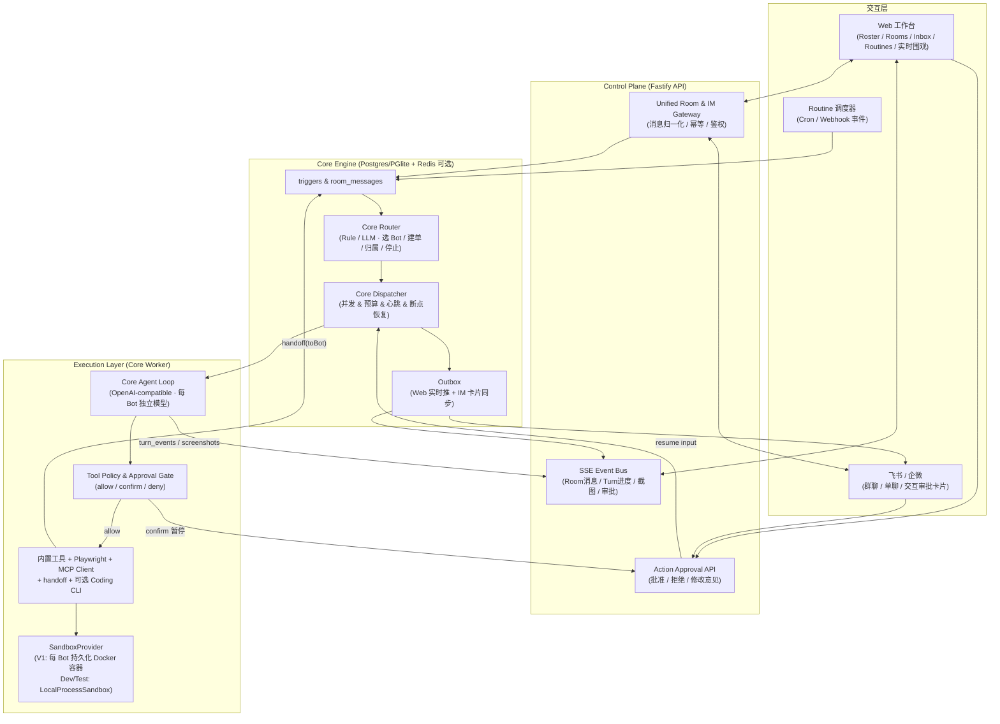
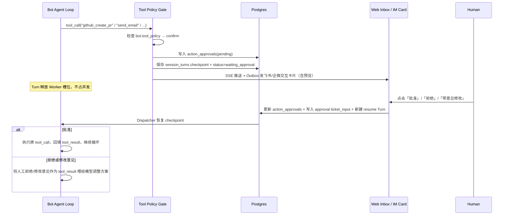

# Superagent Platform → Grok Bot 产研数字员工平台架构设计

- 日期：2026-11-26
- 状态：已完成需求对齐（`/grill-me`），待评审确认后实施
- 目标仓库：`d:\agents\superagent-platform`
- 演进方向：收敛到 `server/src/core/` 唯一内核（下线 `server/src/dual/`），将现有「单项目单仓库工单平台」升级为面向产研团队的 **Grok Bot 风格多 Bot 协作平台**。

---

## 1. 已确认的产品与架构决策

| 维度 | 最终决策 |
| --- | --- |
| **产品定位** | 面向产研团队的多角色数字员工平台（需求调研、产品/设计、编码、QA 巡检等）；保留多项目与 RBAC 协作权限，**Git 仓库改为可选 Connector**，项目无需绑仓库即可激活。 |
| **主交互阵地** | **Web 工作台为主战场**（Rooms 群聊、Bot Roster、实时终端/截图围观、审批收件箱、Routines 看板）+ **飞书/企微做入口与交互卡片双向同步**。 |
| **多 Bot 协作** | **Router 路由 + Bot 显式交接（Handoff）混合模式**：人可点名 `@某Bot` 或泛说由 Router 分派；Bot 完成后可调用 `handoff` 工具 `@` 下游 Bot 接力，配 `maxHops`（默认 5）与单线程预算熔断防循环。 |
| **云电脑 / 沙箱** | **分步演进**：V1 采用**每 Bot 独立持久化 Docker 容器**（持久化 `/home/bot` 卷 + Playwright 浏览器 + MCP 客户端），控制台展示实时终端/截图流；本地开发与单测保留 `LocalProcessSandbox` 降级实现；V2 增加 noVNC/WebRTC 人工接管桌面。 |
| **主动性与复利** | **V1 纳入 7×24 Routines**（Cron 定时与 webhook/仓库事件触发，统一写入 `triggers` 复用整条链路）；Bot 跨任务长期记忆（Memory）与轨迹一键沉淀 Skills 留到 V2。 |
| **护栏与审批** | **工具级「Suggest, don't send」风险拦截** + Web 统一审批收件箱 + 飞书/企微交互卡片（一键批准 / 拒绝 / 带意见打回），暂停 Turn 并在审批后从断点续跑。 |
| **IM 身份映射** | **渐进兼容**：默认复用项目绑定的单 IM 机器人账号，回群带 `[Bot名 · 角色]` 署名与卡片抬头；同时在 `bots` 表预留独立 IM 凭据字段，后续可按需给重点 Bot 挂独立飞书/企微机器人账号。 |
| **内核与运行时** | **彻底收敛到 `core/`（下线 `dual/`）**；以平台自研 **OpenAI-compatible 工具循环**为主运行时（每 Bot 独立配置模型/供应商/温度），原生支持工具级审批暂停、MCP 与 SSE 流式事件；外部 DSH / Coding CLI 退居研发 Bot 可选子工具。 |

---

## 2. 系统总体架构

---

## 3. 核心领域模型与数据库变更

在保留现有 `users`、`projects`、`project_members`、`invites`、`repos`、`channels`、`audit_logs`、`usage`、`outbox_events` 等平台表的基础上，新增 **6 张表** 并扩展核心字段（迁移编号从 `0007` 起）：

### 3.1 新增表

1. **`bots`（数字员工花名册）**
   - `id`, `project_id`, `slug`（项目内唯一，用于 `@slug` 点名）, `name`, `role_title`（如「产品经理」「前端工程师」「QA 巡检」）, `avatar`, `status`（`active` | `paused` | `archived`）
   - `system_prompt`（岗位人设与职责边界）
   - `model_config`（JSONB：`baseUrl` / `apiKeyRef` / `model` / `temperature` / `maxOutputTokens` / `maxSteps`）
   - `tool_policy`（JSONB：允许的工具集、MCP server 绑定、每个工具的风险策略 `allow` | `confirm` | `deny`）
   - `sandbox_config`（JSONB：镜像、CPU/内存上限、持久化卷名、是否启用浏览器、网络白名单）
   - `im_binding`（JSONB，可空：预留独立飞书/企微机器人 `botId`/`appId`/`secretRef`）
   - `sandbox_state`（`stopped` | `starting` | `running` | `error`）、`container_id`、`last_active_at`
   - 索引：`unique(project_id, slug)`

2. **`rooms`（协作房间：Web 原生群聊 / DM / IM 绑定群统一抽象）**
   - `id`, `project_id`, `kind`（`group` | `dm` | `routine_feed`）, `name`, `topic`
   - `channel_id`（可空：关联 `channels.id`，非空表示与飞书/企微群双向同步）
   - `dm_user_id`（可空：单聊归属用户）、`default_bot_id`（可空：单聊默认 Bot）
   - `max_handoff_hops`（默认 5）、`status`（`active` | `archived`）
   - 关联表 **`room_bots`**（`room_id`, `bot_id`, `joined_at`，决定哪些 Bot 在这个房间里在线）

3. **`room_messages`（统一时间线消息流）**
   - `id`, `project_id`, `room_id`, `thread_key`
   - `author_kind`（`user` | `bot` | `system`）、`author_user_id`、`author_bot_id`
   - `kind`（`chat` | `handoff` | `status` | `approval_card` | `artifact` | `report`）
   - `content`（Markdown 文本）、`attachments`（JSONB：截图、文件、PR 链接、Diff 预览）
   - `ticket_id`（可空）、`turn_id`（可空）、`reply_to_id`（可空）
   - `external_provider`、`external_message_id`（用于 IM 双向去重与飞书消息 PATCH 更新）

4. **`action_approvals`（工具级风险拦截审批单，替代单一 `plan_review`）**
   - `id`, `project_id`, `room_id`, `ticket_id`, `turn_id`, `bot_id`
   - `tool_name`、`tool_call_id`、`risk_level`（`medium` | `high`）
   - `title`、`preview`（JSONB：人类可读的操作预览，例如即将发送的邮件正文、PR diff 摘要、将执行的命令、浏览器将点击的按钮截图）
   - `tool_args`（JSONB：待执行的原始参数）
   - `status`（`pending` | `approved` | `rejected` | `revision_requested` | `expired`）
   - `decided_by`、`decision_comment`、`decided_at`、`expires_at`
   - `im_message_ref`（JSONB：已发出的飞书/企微卡片消息 ID，审批后回写更新卡片状态）

5. **`routines`（7×24 定时与事件巡检任务）**
   - `id`, `project_id`, `bot_id`, `room_id`（产出汇报发到哪个 Room）
   - `name`, `description`, `enabled`
   - `trigger_type`（`cron` | `webhook` | `repo_event`）
   - `cron_expr`、`timezone`（如 `Asia/Shanghai`）、`event_filter`（JSONB）
   - `prompt`（每次触发执行的指令）、`max_budget_usd`（单次预算上限）
   - `next_run_at`, `last_run_at`, `last_status`, `last_ticket_id`

6. **`mcp_servers`（项目级 MCP 连接器注册表）**
   - `id`, `project_id`, `name`, `transport`（`stdio` | `sse` | `streamable_http`）
   - `endpoint_or_cmd`, `args`, `env_refs`（只存密钥引用，不明文回传前端）, `enabled`, `default_tool_policy`

### 3.2 现有表扩展与清理

- **`tickets`**：新增 `bot_id`（当前负责的 Bot）、`room_id`、`handoff_chain_id`（同一次多 Bot 接力链 ID）、`handoff_hop`（当前跳数，默认 0）、`parent_ticket_id`（由哪个 Bot 交接产生）；`stage` 新增 `waiting_approval`（等待工具级审批）。
- **`triggers`**：`kind` 枚举新增 `handoff`、`routine`；新增 `room_id`、`target_bot_id`（显式 `@slug` 或 handoff 指定）、`source_bot_id`、`handoff_chain_id`、`handoff_hop`。
- **`session_turns`**：新增 `bot_id`、`checkpoint`（JSONB：工具级审批暂停时保存的完整 `messages[]` 对话状态与待执行 `pendingToolCall`，审批后从断点直接续跑）、`paused_approval_id`、`lease_until`。
- **`turn_events`**：扩展事件类型覆盖 `thinking`、`tool_call`、`tool_result`、`terminal_chunk`、`browser_screenshot`、`approval_requested`、`approval_resolved`、`handoff`。
- **`projects`**：放宽激活条件——创建项目即可直接 `active`（不再强制要求同时绑定 Git 仓库和 IM 群），初始化时可一键导入「产研默认团队模板」（产品、调研、研发、QA 四个预设 Bot + 一个默认主 Room）。
- **下线 `dual/`**：移除 `server/src/dual/`，迁移掉 `agent_sessions(role=main)` 的旧依赖，使 `core/` 成为唯一执行内核。

---

## 4. 关键运行机制设计

### 4.1 统一消息与多 Bot 路由（Router + Handoff）

1. **入口归一化**：Web Room 发消息、飞书/企微群聊或单聊、Routine 定时触发、Bot `handoff` 调用，统一落盘为 `room_messages`（如适用）+ `triggers`，标记对应 `threads.router_pending = true`。
2. **显式点名快路径 + LLM 路由**：
   - 若消息明确 `@bot-slug`（Web 选人或 IM 文本匹配），写入 `target_bot_id`，Router 优先将该 Bot 纳入决策（或直接派发给该 Bot）；
   - 若是泛说需求或 ambient 群聊消息，Router 状态板（`board.ts`）同时展示：房间内在线 Bot 列表（`slug / roleTitle / 职责`）、开放工单列表（**同时展示 `id` 与 `shortName`，并在 `apply.ts` 同时按 UUID 与 `shortName` 解析，彻底修复现有隐患**）、最近消息、当前批次 Trigger。
   - Router 输出 `action: new | attach | ignore | stop` 以及 `botSlug`，落库创建/续跑对应 Bot 的 Ticket 与 Turn。
3. **Bot 间显式交接（`handoff` 工具）**：
   - 内置工具 `handoff({ toBotSlug, summary, context, expectedOutput })`：
     - 校验目标 Bot 在同一 Room（或同项目启用状态）；
     - 校验 `ticket.handoffHop + 1 <= room.maxHandoffHops` 且项目当日 Token 预算未超限；超限时拒绝交接并转为 `blocked` 提醒人工介入；
     - 在 `room_messages` 写入一条可视化的交接卡片消息（`@目标Bot` + 交接摘要），同步 Outbox 到 IM 群；
     - 写入一条 `kind='handoff'`、`source_bot_id`、`target_bot_id`、`handoff_hop = current + 1` 的 Trigger，唤醒下游 Bot 接力。

### 4.2 工具级「Suggest, don't send」审批与断点续跑

- **默认分层策略**：
  - `allow`（低风险只读与工作区内读写）：`read_file`、`list_files`、`web_search`、`browser_navigate`、`browser_screenshot`、在沙箱工作区内的 `write_file` 与测试命令。
  - `confirm`（对外写/不可逆动作）：`github_push_and_pr`、`im_broadcast`、外部写类 MCP 工具（发邮件、改生产库、写线上工单/文档）、高危浏览器提交操作（可按 URL/动作配置）。
  - `deny`：访问宿主机、篡改 git remote、读取密钥环境变量等。
- **不占 Worker 并发**：等待人工审批期间，Turn 进入 `waiting_approval` 并保存完整 `checkpoint`（消息历史 + 待执行的 `toolCall`），Worker 立即释放去服务其他 Bot；人类无论 5 分钟还是 8 小时后点下按钮，Dispatcher 都能毫秒级恢复上下文继续跑。

### 4.3 每 Bot 持久化云电脑（`SandboxProvider`）

抽象统一接口 `SandboxProvider`：
- **`ensureRunning(bot)`**：确保该 Bot 的容器处于运行态（冷启动或唤醒），挂载命名持久化卷 `sa-bot-home-<botId>:/home/bot`；如项目绑定了 Git 仓库，按需将工单 worktree 挂载到 `/workspace/tickets/<ticketId>`。
- **`exec(bot, cmd, opts)`**：在容器内以非 root 用户执行命令，实时流式回传 stdout/stderr chunk 到 `turn_events`（驱动 Web 实时终端）。
- **`browser(bot, action)`**：容器内常驻 Chromium + Playwright（持久化 `--user-data-dir=/home/bot/.browser-profile`），每次导航/点击/填表后自动产出截图存入 artifact 存储并通过 SSE 推送到前端「围观抽屉」。
- **`callMcp(bot, serverId, tool, args)`**：通过项目级 MCP Client 代理调用外部工具，凭证只在控制面/代理层注入，不暴露给容器内任意 shell 命令。
- **双实现保障开发与单测体验**：
  - 生产默认：`DockerSandboxProvider`（通过 Docker Engine API / CLI 管理轻量 Debian + Node + Python + Playwright 基础镜像，严格配置 `--cap-drop=ALL`、`--memory`、`--cpus`、无 Docker socket 挂载，闲置 N 分钟自动休眠容器保留数据卷以省内存）；
  - 开发/CI 降级：`LocalProcessSandboxProvider`（在本地目录隔离执行，确保 `pnpm test` 与 `pnpm demo` 零 Docker 依赖可跑通）。
- **V2 预留**：镜像与 `SandboxProvider` 预留 `getVncSession(bot)` 接口，V2 只需在容器内开启 `xvfb + x11vnc + websockify` 并在 Web 端挂一个 noVNC 组件，即可实现人接管鼠标登录。

### 4.4 7×24 Routines 调度器

- 在 `core-worker` 中新增轻量级 `RoutineScheduler`（每 15 秒扫描 `routines` 中 `enabled = true AND next_run_at <= now()`，使用 `FOR UPDATE SKIP LOCKED` 保证多 Worker 下不重复触发）。
- 触发时：计算下一轮 `next_run_at`，向 `triggers` 插入一条 `kind='routine'`、`external_id='routine:<routineId>:<scheduledIso>'` 的幂等记录，并自动关联目标 `bot_id` 与 `room_id`。
- **静默降噪原则**：Routine Prompt 明确约定——巡检无异常时返回 `status='waiting'` 且仅记录安静摘要（可配置「仅异常时通知 IM 群」），避免每天把飞书/企微群刷成垃圾日志。

### 4.5 实时流式推送与 IM 卡片双向同步

- **SSE 事件流**：新增 `GET /v1/projects/:id/events/stream`（基于内存 PubSub，多实例时复用 Redis Pub/Sub），实时推送：
  - `room.message`（新消息 / Bot 回复 / Handoff 卡片）
  - `bot.status`（空闲 / 思考中 / 正在执行工具 / 等待审批）
  - `turn.event`（工具调用进度、实时终端输出、最新浏览器截图 URL）
  - `approval.created` / `approval.resolved`
- **IM 双向同步**：
  - 飞书适配器升级（[feishu.ts](file:///d:/agents/superagent-platform/server/src/im/feishu.ts)）：支持真正的 `msg_type: 'interactive'` 卡片（进度卡片支持 `PATCH /open-apis/im/v1/messages/:id` 原地刷新；审批卡片带「批准 / 拒绝」按钮，注册飞书卡片回调 `/webhooks/feishu/card`）。
  - 企微适配器升级（[wecom-bot.ts](file:///d:/agents/superagent-platform/server/src/im/wecom-bot.ts)）：Markdown 进度消息 + 审批操作链接/模板卡片，点击跳转 Web 审批收件箱或回调完成批复。

---

## 5. Web 工作台信息架构（重塑）

将现有 10 Tab 研发后台重排为 **「左侧团队导航 + 中央主工作区 + 右侧实时围观抽屉」**：

- **一级视角（项目内核心工作台）**：
  1. **协作房间（Rooms）**：默认首页。类似 Slack/群聊界面，左侧房间列表（含主群、专题 Room、与 Bot 单聊 DM），中间富消息流（支持 `@Bot` 自动补全、看到多个 Bot 头像接力协作、内联进度条、内联审批卡片），右侧可一键展开「围观抽屉」（实时终端日志 + 最新浏览器截图 + 当前工单 Diff/PR）。
  2. **Bot 团队（Roster）**：卡片墙展示项目内所有数字员工（状态灯、当前任务、模型、沙箱状态、快捷「私聊 / 启停 / 配置」按钮），支持一键从产研模板创建 Bot（产品经理、需求研究员、全栈工程师、QA 巡检）。
  3. **审批收件箱（Inbox）**：集中展示跨 Room、跨 Bot 的所有 `pending` 工具审批单，支持预览操作详情（命令/PR/消息/截图），一键「批准」「拒绝」或输入修改意见打回。
  4. **定时巡检（Routines）**：所有 7×24 任务的列表、Cron 可视化配置、开关、手动「立即试跑」和最近运行记录。
- **二级视角（折叠进「项目设置与管理」分组）**：工单总表（兼容原有视图）、Router Runs 诊断、连接器（GitHub/本地仓库 + MCP Servers）、IM 群绑定、成员与邀请、审计与用量。

---

## 6. 风险与护栏

| 风险 | 缓解措施 |
| --- | --- |
| 多 Bot 互 `@` 死循环烧钱 | 强制 `maxHops`（默认 5）+ 单线程与每日项目 Token 预算硬拦截 + 同一 Bot 不可连续交接给自己。 |
| 持久化容器资源膨胀 | 闲置自动休眠（保留命名卷不丢状态）+ 项目级最大活跃容器数配额 + 单容器 CPU/内存/磁盘限额。 |
| 浏览器/工具越权访问内网或泄露密钥 | 容器无 Docker socket、非 root、独立网段禁止访问宿主机 metadata/内网段；MCP/GitHub 密钥留在控制面不进容器 env。 |
| 审批暂停后上下文失真 | `checkpoint` 序列化保存完整 LLM `messages` + `toolCall`，审批超时（默认 24h）自动过期并通知发起人。 |
| `dual/` 移除引发回归 | Phase 0 先把现有 59 个旧测试核心场景迁到 `core/` 测试集并全绿后再删 `dual/`，保证 Auth/RBAC/IM/GitHub 零退化。 |
